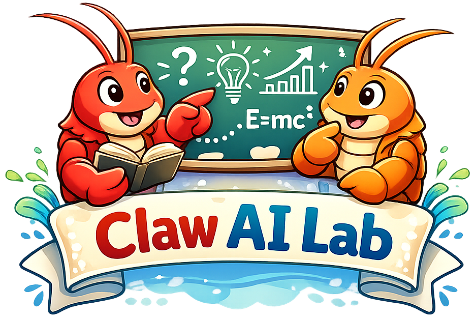
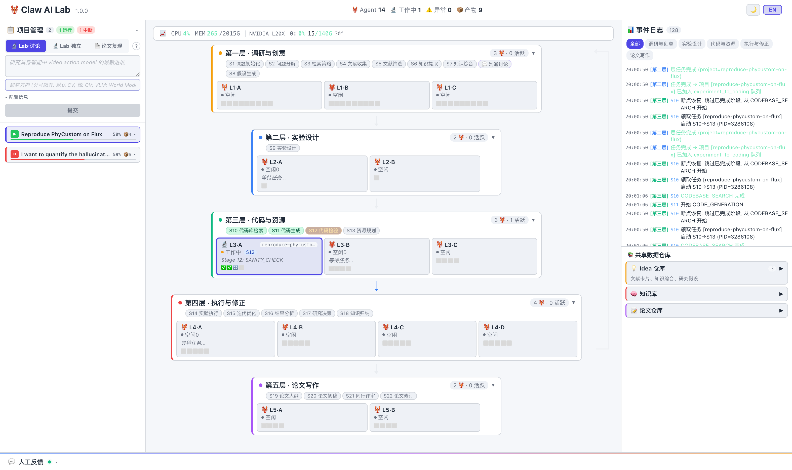
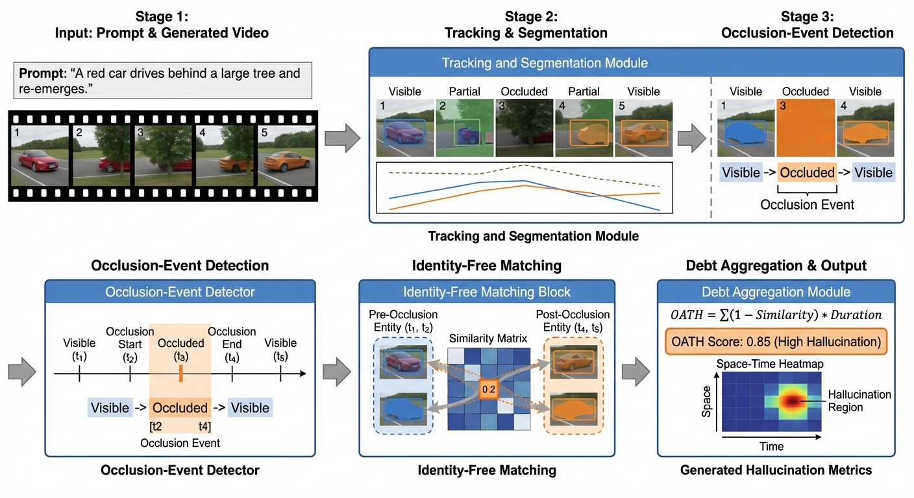
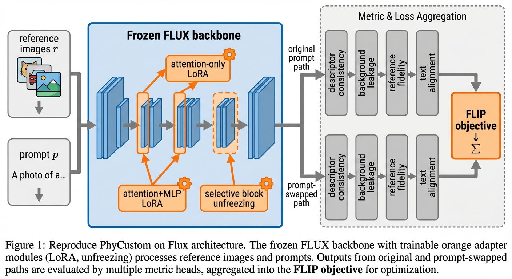
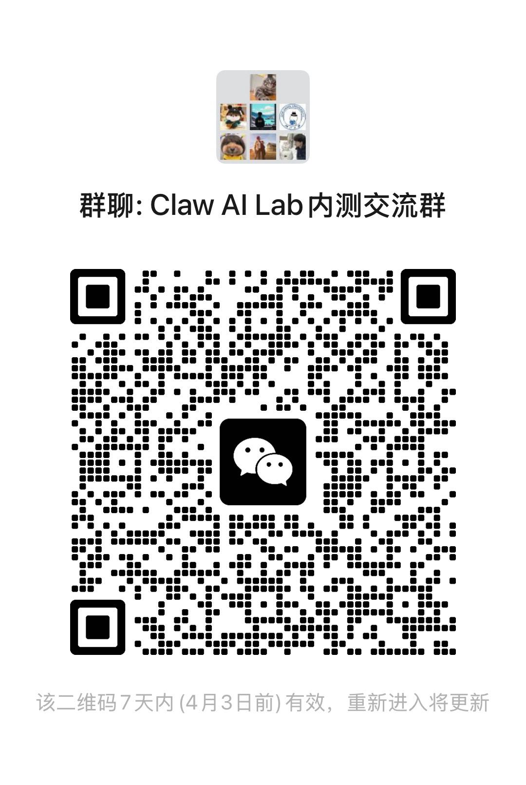
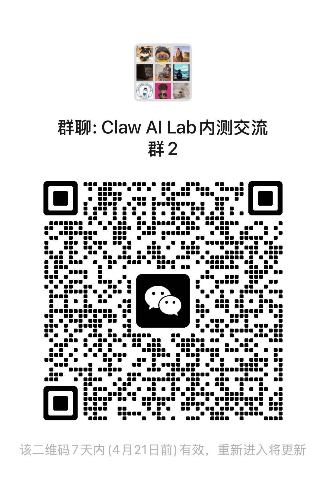

<p align="center">
  
</p>

<h1 align="center">Claw AI Lab</h1>

<p align="center">
  <b>An Autonomous Multi-Agent Research Team</b><br>
  <i>One dashboard. An entire research team.</i>
</p>

<p align="center">
  <a href="https://arxiv.org/abs/2605.22662"></a>
  <a href="#license"></a>
  <a href="https://python.org"></a>
  <a href="https://nodejs.org"></a>
</p>

<p align="center">
  <a href="#overview">Overview</a> ·
  <a href="#key-features">Features</a> ·
  <a href="#showcase">Showcase</a> ·
  <a href="#quick-start">Quick Start</a> ·
  <a href="#configuration-reference">Configuration</a> ·
  <a href="#contributing">Contributing</a> ·
  <a href="#citation">Citation</a> ·
  <a href="#community">Community</a>
</p>

---

## Updates

- **[2026.05]** Technical report released on arXiv: [*Claw AI Lab: An Autonomous Multi-Agent Research Team*](https://arxiv.org/abs/2605.22662).
- **[2026.04.02]** Preview v1.1.0 — powered by **Claw-Code Harness**.
- **[2026.03.25]** Preview v1.0.0 — initial release.

---

## Overview

**Claw AI Lab** is a lab-native multi-agent research platform for interactive, scalable AI-driven science. From a single prompt, it spins up a coordinated AI research team—complete with literature review, ideation, coding, experimentation, figure generation, and paper writing—managed through a unified web dashboard.

- **Lab-Native Multi-Agent Team:** Configure customizable roles, research directions, and collaborative workflows instead of relying on a single agent or a rigid serial pipeline.
- **Parallel Scheduling & Knowledge Sharing:** Orchestrate multiple agents and projects concurrently with a FIFO-based scheduler, maximizing compute utilization while sharing findings across runs.
- **Human-in-the-Loop Control:** Intervene at any point to resolve ambiguity, inject new ideas, or iteratively refine research via rollback and continuation.
- **Unified Dashboard:** Turn end-to-end automated research into prompts and clicks—monitor live events, manage queues, and inspect every artifact in one place.

> Community contributions are warmly welcome—see [Contributing](#contributing) or join our [Community](#community) group for beta testing and discussion.

---

## Dashboard

<p align="center">
  
  <br/>
  <b>Launch projects, monitor agents, and inspect every artifact from a single interface.</b><br>
  <sub>Real-time event stream · Multi-project overview · One-click rollback &amp; resume · Artifact inspector</sub>
</p>

---

## Key Features

| Capability | Description |
| :--- | :--- |
| **Interactive Dashboard** | Real-time web UI with live event stream, data shelf, multi-project monitoring, rollback/resume, and artifact inspection. |
| **Claw-Code Harness** | Reads your local codebases, datasets, and checkpoints—and writes runnable experimental code directly back to disk. |
| **End-to-End Pipeline** | Goes from one prompt to a complete deliverable: paper, runnable code, figures, and experiment logs. |
| **Three Research Modes** | **Explore** (open-ended research), **Discussion** (multi-agent debate & consensus), and **Reproduce** (empirical reproduction). |
| **Flexible Model & Search Stack** | Supports OpenAI-compatible, OpenAI, DeepSeek, and ACP providers; separate text/coding/image model endpoints; fallback chains; and optional Exa/Tavily web search. |

---

## Showcase

### Generated Projects

Each project autonomously produces a complete research package: **Paper · Code · Figures · Experiment Logs**.

<table width="100%">
<tr>
<td align="center" width="50%">
<a href="assets/showcase/showcase-quantify-hallucination.md"><b>OATH: Quantifying Video Hallucination via Occlusion Debt</b></a><br>
<sub>Lab Explore · CV · Video Generation Evaluation</sub><br><br>
<a href="assets/showcase/showcase-quantify-hallucination.md"></a><br>
<sub>Best method achieves <b>0.1714</b> primary error vs. CLIP-T baseline <b>0.2393</b> (↓28%)</sub>
</td>
<td align="center" width="50%">
<a href="assets/showcase/showcase-reproduce-phycustom-on-flux.md"><b>Reproducing PhyCustom on FLUX</b></a><br>
<sub>Reproduce · Image Gen · Multi-Concept Customization</sub><br><br>
<a href="assets/showcase/showcase-reproduce-phycustom-on-flux.md"></a><br>
<sub>5 methods × 3 seeds = 15 runs; output-space decoupling leads at <b>0.2813</b></sub>
</td>
</tr>
</table>

<details>
<summary><b>More Generated Project Showcases</b></summary>

- [**ReMRSA: Adaptive Reference Attention for FreeCustom Composition**](assets/showcase/showcase-adaptive-mrsa.md) — *Lab Explore · Discussion Mode*
- [**Architecture-Conditioned Dropout: A Cross-Domain Benchmark Across CV, NLP, and Speech**](assets/showcase/showcase-dropout-cross-domain.md) — *Lab Explore · Discussion Mode (3 Angles)*
- [**WAF: Empirical Reproduction of FlowEdit on Wan2.1-T2V**](assets/showcase/showcase-flowedit-wan21-t2v.md) — *Reproduce*

</details>

### Discussion Mode

Multi-agent debate on: **"What is the most deployable direction for Video Action Models in Embodied AI?"**

> **Agent A** — World Model + MPC (Model Predictive Control) is the most industrially stable path.
>
> **Agent B** — "Train with video, infer with action" is the most deployable policy paradigm.
>
> **Agent C** — Execution monitoring & SOP (Standard Operating Procedure) automation lands fastest as a product.

**Consensus:** The most deployable form is not a single end-to-end model, but a **layered, modular system**—use video supervision during training to learn rich dynamics, output actions directly at inference for low latency, and layer planning, MPC, and safety modules on top for closed-loop robustness and recovery.

<details>
<summary><b>Top 3 Research Directions (ranked by deployability)</b></summary>

| # | Direction | Deployability |
| :---: | :--- | :--- |
| 1 | **Layered Video-Action Stack** — video-action joint training + direct action inference + MPC safety | Highest — best balance of latency, interpretability, and safety |
| 2 | **Video-to-Plan / SOP** — demo videos → step sequences & skill graphs for existing robots | High — smallest embodiment gap, clearest commercial path |
| 3 | **Execution Monitor** — real-time step tracking, anomaly detection, and re-planning triggers | High — fastest to production; critical for industrial reliability |

</details>

<details>
<summary><b>Key Contradictions Resolved</b></summary>

| Debate | Resolution |
| :--- | :--- |
| World Model + MPC vs. Direct Action? | **Combine both** — world model for representation, direct action for control, MPC for safety |
| Human video: valuable or too much gap? | **Pre-training yes**; direct low-level transfer is not yet reliable |
| Is monitoring a "real" action model? | Not the backbone, but **fastest to reach production value** |

</details>

**[Full Transcript →](assets/showcase/discussion_transcript.md)** · **[Consensus Synthesis →](assets/showcase/consensus_synthesis.md)**

---

## Quick Start

**Prerequisites:** Python 3.11+ (Conda recommended) and Node.js 18+.

### 1. Install

```bash
git clone https://github.com/Claw-AI-Lab/Claw-AI-Lab.git
cd Claw-AI-Lab

# Create Python environment
conda create -n clawailab python=3.11
conda activate clawailab

# Backend
cd backend/agent
pip install -e ".[all]"
pip install websockets

# Frontend
cd ../../frontend
npm install
cd ..

# ML dependencies (add extra packages as needed for your domain)
pip install torch torchvision diffusers transformers accelerate safetensors datasets \
            huggingface_hub opencv-python pandas matplotlib scikit-image scipy einops tqdm
```

### 2. Configure

Edit `examples/config_template.yaml` with your LLM credentials and local Python environment path:

```yaml
llm:
  base_url: "your-api-endpoint"
  api_key: "your-api-key"
  primary_model: "gpt-5.4"
  coding_model: "gpt-5.4"
  image_model: "gemini-3-pro-image-preview"
  image_base_url: ""   # Optional: separate endpoint for image generation (defaults to base_url)
  image_api_key: ""    # Optional: separate API key for image generation (defaults to api_key)
  fallback_models:
    - "qwen3.5-plus"
    - "qwen-plus"

experiment:
  sandbox:
    python_path: "/absolute/path/to/clawailab/bin/python"  # Run: conda activate clawailab && which python
```

### 3. Run

```bash
./start.sh              # Start all services (resource monitor, agent bridge, frontend)
./start.sh status       # Check service status
./start.sh restart      # Restart all services
./start.sh stop         # Stop all services
./start.sh reset-state  # Clear persisted projects, queues, and shared indices (run after stop)
./start.sh fresh        # Stop, reset state, and start cleanly
```

Open **http://localhost:5903/** in your browser, submit a research topic, and monitor your agents live.

> **Custom ports:** If default ports (`5903`, `8905`, `8906`) are in use, override them at launch:
> `RESOURCE_MONITOR_PORT=8915 AGENT_BRIDGE_PORT=8916 FRONTEND_PORT=5913 ./start.sh`

---

## Tips for Best Results

| # | Recommendation | Why |
| :---: | :--- | :--- |
| 1 | **Prepare local codebases, datasets & checkpoints** and provide their paths when submitting a project | Avoids large downloads and transient network failures during experiment runs |
| 2 | **Use a strong coding model (e.g., `gpt-5.4`)** | Produces higher-quality experiment code with fewer debug iterations |
| 3 | **Verify the `IMPORTANT` fields in [Configuration Reference](#configuration-reference)** | Misconfigured API keys, Python paths, or time budgets are the #1 cause of failed runs |

---

## Configuration Reference

Full field-by-field guide for `examples/config_template.yaml`. Fields marked **IMPORTANT** are the ones you almost always need to configure before running.

<details>
<summary><b>Click to expand full configuration reference</b></summary>

```yaml
# === Project ===
project:
  name: "__PROJECT_ID__"          # Project identifier, used for directory naming and UI display
  mode: "full-auto"               # Pipeline mode: "full-auto" runs all stages without human gates

# === Research ===
research:
  topic: "__TOPIC__"              # Research topic or paper to reproduce (required)
  domains:                        # Research domains for literature search scope
    - "deep-learning"
  daily_paper_count: 5            # Number of papers to retrieve per search query
  quality_threshold: 3.0          # Minimum relevance score (1-5) for literature screening
  reference_papers: []            # List of reference paper titles or arXiv IDs

# === Notifications ===
notifications:
  channel: "console"              # Notification channel: "console" | "discord" | "slack"
  on_stage_start: true            # Notify when a stage begins
  on_gate_required: true          # Notify when human approval is needed

# === Knowledge Base ===
knowledge_base:
  backend: "markdown"             # Storage format: "markdown" | "obsidian"
  root: "docs/kb"                 # Root directory for knowledge base files

# === OpenClaw Bridge ===
openclaw_bridge:
  use_message: false              # Enable progress notifications via messaging platforms
  use_memory: false               # Enable cross-session knowledge persistence
  use_web_fetch: false            # Enable live web search during literature review

# === LLM ===
llm:
  provider: "openai-compatible"   # LLM provider: "openai-compatible" | "openai" | "deepseek" | "acp"
  base_url: "your-api-endpoint"   # ⚠️ IMPORTANT: API endpoint URL
  api_key: "your-api-key"         # ⚠️ IMPORTANT: API key (or set via api_key_env)
  api_key_env: "RESEARCHCLAW_API_KEY"  # Environment variable fallback for API key
  primary_model: "gpt-5.4"        # ⚠️ IMPORTANT: Main model for research, analysis, and writing
  coding_model: "gpt-5.4"         # ⚠️ IMPORTANT: Model for code generation (S11)
  image_model: "gemini-3-pro-image-preview"  # ⚠️ IMPORTANT: Model for paper figure generation
  image_base_url: ""              # Optional: separate API endpoint for image generation (falls back to base_url)
  image_api_key: ""               # Optional: separate API key for image generation (falls back to api_key)
  fallback_models:                # Fallback model chain when primary model fails
    - "qwen3.5-plus"
    - "qwen-plus"

# === Security ===
security:
  hitl_required_stages: []        # Stage numbers requiring human approval (e.g., [5, 9, 20])

# === Experiment ===
experiment:
  mode: "sandbox"                 # Execution mode: "sandbox" (local Python) | "docker" | "simulated"
  time_budget_sec: 2400           # ⚠️ IMPORTANT: Max wall-clock time per experiment run (seconds)
  max_iterations: 3               # Iterative refinement cycles in S15 (Edit-Run-Eval loop)
  metric_key: "primary_metric"    # Primary evaluation metric name
  metric_direction: "minimize"    # Optimization direction: "minimize" | "maximize"
  datasets_dir: ""                # ⚠️ IMPORTANT: Absolute path to datasets directory
  checkpoints_dir: ""             # ⚠️ IMPORTANT: Absolute path to model weights directory
  codebases_dir: ""               # Absolute path to reference codebases directory
  shared_results_dir: "runs/shared_results"  # Directory for cross-project shared results
  paper_length: "long"            # Paper length: "short" (~4 pages) | "long" (~8 pages)
  sandbox:
    python_path: "__PYTHON_PATH__"  # ⚠️ IMPORTANT: Python interpreter for running experiments
  sanity_check_max_iterations: 100  # Max fix attempts in S12 code testing

# === Runtime ===
runtime:
  timezone: "Asia/Shanghai"       # Timezone used for scheduling and logs

# === Web Search ===
web_search:
  enabled: true                   # Enable external web search tools
  # exa_api_key_env: "EXA_API_KEY"      # Optional: Exa AI search (https://exa.ai)
  # exa_search_type: "auto"             # auto | neural | fast
  # tavily_api_key_env: "TAVILY_API_KEY"  # Optional: Tavily search

# === Prompts ===
prompts:
  custom_file: ""                 # Path to custom prompts YAML file (empty = use defaults)
```

</details>

---

## Contributing

We welcome bug reports, feature proposals, documentation improvements, and pull requests!

1. **Base branch:** Active development targets the default branch `preview-v1.1.0`.
2. **Create a branch** (or fork the repository if you do not have direct push access):
   ```bash
   git checkout -b feat/your-change
   ```
3. **Verify your changes** before opening a PR:
   - Backend (`backend/agent`): run `pytest`
   - Frontend (`frontend`): run `npm run lint && npm run build`
4. **Open a Pull Request** against `preview-v1.1.0` with a clear summary of what changed and why.

For bugs or feature ideas, please open a [GitHub Issue](https://github.com/Claw-AI-Lab/Claw-AI-Lab/issues).

---

## Acknowledgements

Claw AI Lab builds upon ideas and code from [AutoResearchClaw](https://github.com/aiming-lab/AutoResearchClaw), [AutoResearch](https://github.com/karpathy/autoresearch), and [claw-code](https://github.com/ultraworkers/claw-code). We thank the authors for their contributions to the open-source research community.

---

## Citation

If you find Claw AI Lab useful in your research, please cite:

```bibtex
@article{wu2026claw,
  title={Claw AI Lab: An Autonomous Multi-Agent Research Team},
  author={Wu, Fan and Chen, Cheng and Tan, Zhenshan and Zhang, Taiyu and Xu, Xinzhen and Qian, Yanyu and Gao, Dingcheng and Zhu, Lanyun and Zhu, Qi and Tan, Yi and others},
  journal={arXiv preprint arXiv:2605.22662},
  year={2026}
}

@misc{wu2026clawailab,
  author       = {Wu, Fan and Chen, Cheng and Tan, Zhenshan and Zhang, Taiyu and Xu, Xinzhen and Qian, Yanyu and
                  Gao, Dingcheng and Zhu, Lanyun and Zhu, Qi and Tan, Yi and Ji, Deyi and 
                  Lin, Guosheng and Chen, Tianrun and Ye, Deheng and Liu, Fayao},
  title        = {Claw AI Lab: An Autonomous Multi-Agent Research Team},
  year         = {2026},
  url          = {https://github.com/Claw-AI-Lab/Claw-AI-Lab},
  note         = {GitHub repository}
}
```

---

## License

This project is released under the **MIT License**.

---

## Community

Join our WeChat groups for beta testing, Q&A, and research discussions:

<p align="center">
  
  
</p>
